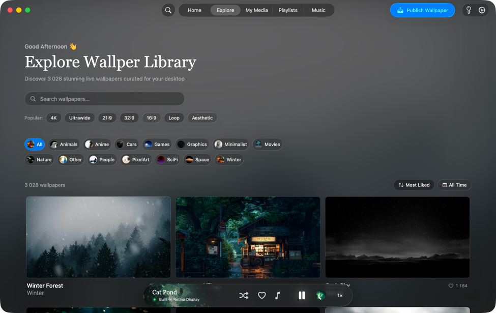
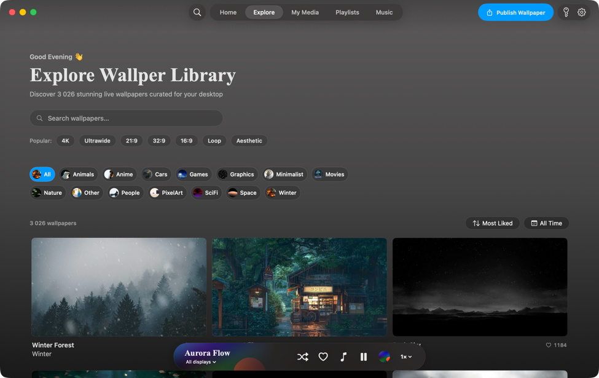
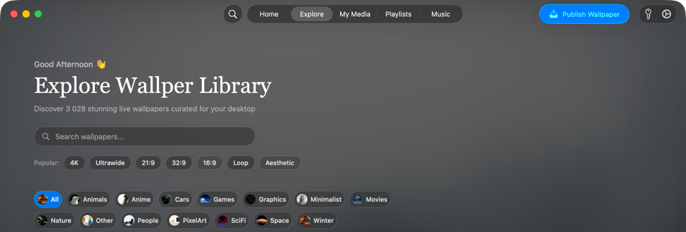
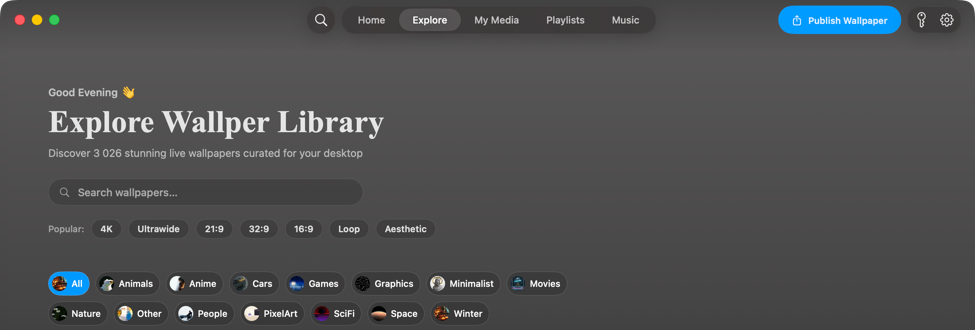
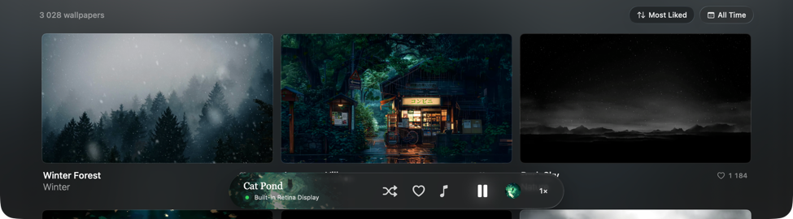
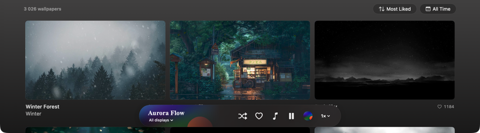

# UI comparison and recovery findings

Native window captures were compared on October 29, 2026. The reference and
rebuilt Explore windows both measured **1300×820 points** and were floating,
not fullscreen. Several build/capture passes corrected the earlier tiled view.

## Saved comparisons

| Original Explore | Rebuilt Explore |
| --- | --- |
|  |  |

Header and category controls:

| Original | Rebuilt |
| --- | --- |
|  |  |

Gallery and playback dock:

| Original | Rebuilt |
| --- | --- |
|  |  |

The dock deliberately shows the video actually playing in each app, rather than
copying the reference's title or playback state. The greeting is time-dependent.

## Corrections made

- Replaced the sidebar with centered capsule navigation and a search button.
- Matched the serif heading using Times New Roman Bold at 42 points.
- Matched the 420×36 search field, popular filters, and two-row category flow.
- Preserved catalog ordering for category cover art while sorting gallery cards
  by likes independently. This restores the reference's category thumbnails.
- Restored the three-column 16:9 gallery, 12-point spacing, rounded previews,
  titles, categories, and snapshot like counts.
- Positioned native window buttons at the reference inset, including after resize.
- Restored capsule sort/date controls and a bottom floating playback dock with
  current artwork, display selection, favorites, shuffle, pause, and speed.
- Used a behind-window visual-effect background and darker lower gradient.
- Found AeroSpace tiling was expanding the reconstructed window. The app now
  requests floating for its own window only; no global configuration is edited.

This is a close reconstruction of the Explore layout, not a claim of pixel-perfect
equivalence. Native material rendering, hover/focus effects, and some controls
can still differ. These captures do not establish parity for every original tab,
dialog, account feature, or macOS version.

## Wallpaper recovery

- The public catalog contains 3,026 approved records and 353 cached previews.
  Two declined records are excluded, so the count differs from the original's
  3,028-entry display. No account/reviewer identifiers or credentials are bundled.
- Nine downloaded videos were copied to the separate app-support library and
  verified byte-for-byte with SHA-256. Original files remain unchanged; the
  videos are not checked into Git.
- Other gallery videos download on demand after confirmation. Official and
  community entries use different public CDN buckets.
- Actual download testing caught an AVFoundation failure when CFNetwork's `.tmp`
  path was passed directly to the media loader. Downloads are now staged with a
  video extension before validation and import.
- All 37 native checks passed with network validation enabled, including import,
  persistence, playback/looping, speed, download, playable tracks, and cleanup.
  This is not a guarantee that all remote catalog URLs remain available.

## Reproduce the comparison

Open both library windows, then run from the repository root:

```sh
swift tools/capture-ui-comparison.swift "$PWD/build/design-reference"
```

The script captures only the app windows, not the desktop. It uses AeroSpace
focus when available and finishes with the rebuilt app selected. It writes full
window captures, resized overviews, header/dock crops, and window measurements.
It requires macOS screen-recording permission, but does not use Accessibility
automation. Full-resolution iteration captures and test reports remain in
ignored `build/`; the resized comparison images here are committed documentation.
